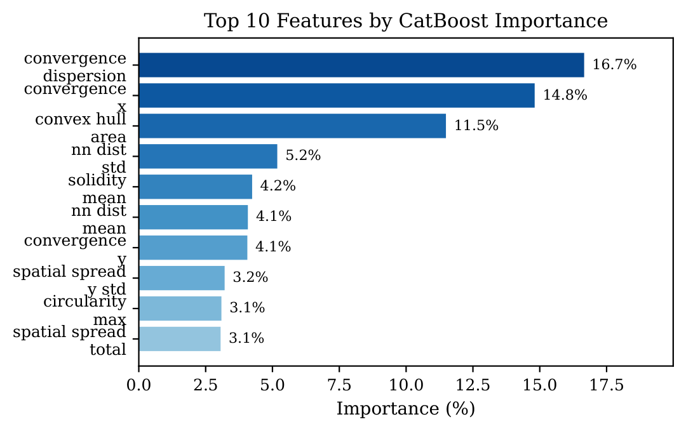

# Seeing the Story in Blood: An Explainable Computer Vision Framework for Forensic Bloodstain Pattern Classification

A three-class classifier that separates gunshot, impact, and low-velocity bloodstain patterns from photographs of the stain pattern, using geometry rather than stain appearance, and explains every decision.




**Status:** accepted at IEEE COMPAS 2026 (3rd International Conference on Computing, Applications and Systems, 9-10 October 2026, University of Dhaka, Bangladesh), paper ID 268; the IEEE copyright and consent form is signed. IEEE Xplore indexing is expected and not yet confirmed. The manuscript is not part of this repository: this repository holds the code, the extracted feature table and the reported results.

## What this is

Bloodstain pattern analysis asks which physical mechanism produced a set of stains. Human examiners disagree with each other on this question, and most machine learning work on the problem treats it as a binary decision, gunshot or not, which collapses a hammer blow and a nosebleed into the same negative class. This repository implements a three-class alternative: it extracts 30 physics-informed geometric features from each photographed pattern, including three convergence features that estimate where the stain trajectories originate and how tightly they cluster around that origin, and classifies with CatBoost under SqrtBalanced class weighting. On 618 images drawn from three published laboratory corpora it reaches 92.6% accuracy and 0.8648 macro F1, and the convergence features alone carry 35.5% of the model's total feature importance. SHAP TreeExplainer output is used for global and per-class attribution, so the classifier reports which geometric property drove each decision rather than only a label. The main finding is that the latent geometry of the whole pattern is more diagnostic than the morphology of individual stains.

The evaluation is limited to controlled laboratory images. The paper reports source and substrate confounding as an open limitation, so the numbers below describe this corpus and not field performance.

## Key results

Five classifiers, same 30 features, 5-fold stratified cross-validation on 618 images:

| Model | Accuracy | F1 macro | F1 weighted |
|---|---|---|---|
| **CatBoost (SqrtBalanced)** | **0.9256** | **0.8648** | **0.9271** |
| XGBoost | 0.9223 | 0.8638 | 0.9225 |
| Random Forest | 0.9175 | 0.8536 | 0.9174 |
| Logistic Regression | 0.8981 | 0.8254 | 0.9004 |
| SVM (RBF) | 0.8981 | 0.8279 | 0.9003 |

CatBoost per-class F1: gunshot 0.895, impact 0.735, low velocity 0.964. The paper's imbalance table reports the best non-CatBoost combination at 0.844 macro F1, BorderlineSMOTE with XGBoost, 0.02 below CatBoost SqrtBalanced; the shipped `results/exp4_class_imbalance.json` holds the 12-run weighted, SMOTE and undersampling subset.

**Evaluation protocol:** 5-fold stratified cross-validation, seed 42, over the 618 images that remain after removing 44 with zero detected stains. The class split is 71 gunshot, 79 impact, 468 low velocity, so the minority classes hold fewer than 80 examples each. The table reports a single seed; no seed-variance study is reported, and the 0.001 macro F1 gap between CatBoost and XGBoost is not evidence of a stable ordering.

## Repository layout

```
run_pipeline.py      entry point: manifest, features, train, shap, test
golden_path.py       reproduces the headline model, metadata and SHAP output
bpa/                 pipeline package
  stain_detection.py     stain segmentation and per-stain measurements
  feature_extraction.py  30 geometric features per pattern
  unified_manifest.py    builds the manifest from the source corpora
  train_classifier.py    classifiers, experiments 1 to 4, cross-validation
  shap_analysis.py       TreeExplainer attribution
  tune_model.py          hyperparameter and imbalance search
  save_final_model.py    refits and writes models/
  process_kannan.py      one-off Kannan corpus conversion
data/                features.csv: 662 rows, 35 columns, 30 features per pattern
results/             exp1 to exp4 JSON outputs: within-source, cross-source, binary ablation, imbalance
models/              final CatBoost pipeline (joblib), model_metadata.json, feature_importances.json
assets/              figure used in this README
requirements.txt     pinned dependencies
LICENSE              MIT
```

## Install

Python 3.11. The pipeline is CPU only; no CUDA is required.

```bash
python -m venv .venv
# Windows
.venv\Scripts\activate
# Linux or macOS
source .venv/bin/activate

pip install -r requirements.txt
```

The versions in `requirements.txt` are the ones the reported metrics were reproduced with.

## Reproduce

The repository ships the extracted feature table, so the modelling stages run without the source photographs.

**Stage 1, experiments.** Regenerates the four result files from `data/features.csv`.

```bash
python run_pipeline.py --step train
```

Expected artifacts: `results/exp1_within_source.json`, `results/exp2_cross_source.json`, `results/exp3_binary_ablation.json`, `results/exp4_class_imbalance.json`, and `results/label_mapping.json`.

**Stage 2, final model and SHAP.** Recomputes the cross-validated metrics in `models/model_metadata.json` and writes `shap_results/` (gitignored).

```bash
python golden_path.py
```

Expected artifacts: `models/bpa_classifier_final.joblib`, `models/model_metadata.json`, `models/feature_importances.json`, and `shap_results/global_summary.png`. Running this stage overwrites the tracked model files.

**Stage 3, feature extraction (needs the source images).** The raw corpora are not shipped in this repository. `run_pipeline.py --step manifest` expects the image tree under a sibling `BPA2` directory, set as `BPA2_DIR` at the top of the script, and `--step features` then rebuilds `data/features.csv`.

```bash
python run_pipeline.py --step manifest
python run_pipeline.py --step features
```

## Citation

```bibtex
@inproceedings{mahmood2026seeing,
  title     = {Seeing the Story in Blood: An Explainable Computer Vision Framework for Forensic Bloodstain Pattern Classification},
  author    = {Mahmood, Abdullah and Hasan, MD Zahid and Sany, Asif Alfa and Paul, Punam and Rahman, Tasmiah and Johora, Fatema Tuz},
  booktitle = {2026 IEEE 3rd International Conference on Computing, Applications and Systems (COMPAS)},
  year      = {2026},
  address   = {Dhaka, Bangladesh}
}
```

## License

MIT, Copyright (c) 2026 Abdullah Mahmood (see `LICENSE`). The source bloodstain corpora belong to their original authors and are not redistributed.

## Data sources

The 618 images come from three published corpora: Attinger laboratory patterns (79 impact, 43 low velocity, 68 gunshot), Ferrarini laboratory gunshot patterns (16), and the Kannan drip corpus (457 low-velocity patterns from bovine blood across four substrates). After preprocessing, one unreadable Attinger gunshot file and 44 images with zero detected stains were excluded.
